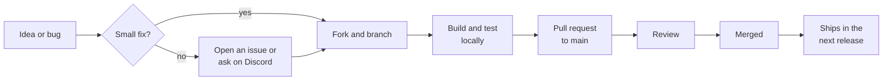

<div align="center">


# Contributing to Nexus

Nexus is free, open source and MIT licensed.<br>
Bug reports, ideas, code, docs and website fixes are all welcome.

<br>

**[Report a bug](https://github.com/darrenstrydom85/nexus_game-launcher/issues/new?labels=bug)** &nbsp;·&nbsp;
**[Suggest a feature](https://github.com/darrenstrydom85/nexus_game-launcher/issues/new?labels=enhancement)** &nbsp;·&nbsp;
**[Ask on Discord](https://discord.gg/dh2tDGJNYD)**

</div>

<br>

## Contents

- [How a contribution works](#how-a-contribution-works)
- [Ways to help](#ways-to-help)
- [Set up your machine](#set-up-your-machine)
- [Find your way around](#find-your-way-around)
- [Make your change](#make-your-change)
- [Check it before you push](#check-it-before-you-push)
- [Open a pull request](#open-a-pull-request)
- [How your change ships](#how-your-change-ships)
- [Reporting bugs](#reporting-bugs)
- [Security issues](#security-issues)
- [Be kind](#be-kind)
- [License](#license)

<br>

## How a contribution works



1. **Talk first for anything big.** Typos, small bugs and obvious fixes can go straight to a pull request. For a new feature, a new game source or anything that changes how Nexus stores data, open an issue or ask on Discord first. That way nobody spends a weekend on something that won't be merged.
2. **Fork, branch, build.** Work on a branch in your fork and run the app locally.
3. **Run the checks.** The same build, tests and lints the maintainer runs before every release.
4. **Open a pull request against `main`.** Say what changed and why, and show it working.
5. **Review.** Every PR needs one approving review before it can merge. Expect questions; they're how the code stays maintainable.
6. **Merge and release.** Once merged, your change goes out in the next release and installed copies of Nexus update themselves.

<br>

## Ways to help

| You want to… | Start here |
|:--|:--|
| Report something broken | [Open a bug report](#reporting-bugs) |
| Suggest a feature | [Open an issue](https://github.com/darrenstrydom85/nexus_game-launcher/issues/new?labels=enhancement) with the problem it solves |
| Fix a bug or build a feature | Read on, then pick an issue labelled `good first issue` or `help wanted`, or one you've raised |
| Improve the docs | `README.md`, this file, or `docs/` |
| Fix the website | Plain HTML in [`nexus-website/`](nexus-website), no build step |
| Test a new release | Install it, play, and tell us on [Discord](https://discord.gg/dh2tDGJNYD) what broke |

Areas that would help most right now:

- Support for more launchers and game sources
- Better metadata matching (IGDB, SteamGridDB, How Long to Beat)
- Faster library scanning and duplicate detection
- Accessibility: keyboard navigation, focus states, screen reader labels
- Clearer error messages when a launch or scan fails

<br>

## Set up your machine

<details open>
<summary><b>Prerequisites</b></summary>
<br>

- **Windows 10 or 11**, 64-bit
- **Node.js** 20.19+ or 22.12+ (Vite 7 needs one of these)
- **Rust**, latest stable via [rustup](https://rustup.rs)
- **[Microsoft C++ Build Tools](https://visualstudio.microsoft.com/visual-cpp-build-tools/)** with the *Desktop development with C++* workload
- **[WebView2](https://developer.microsoft.com/en-us/microsoft-edge/webview2/)**, preinstalled on Windows 11

</details>

Fork the repo on GitHub, then:

```powershell
git clone https://github.com/YOUR_USERNAME/nexus_game-launcher.git
cd nexus_game-launcher/nexus
npm install
npm run tauri dev
```

The first run compiles the Rust core and takes a few minutes. After that the window opens with hot reload, and the frontend is served at `http://localhost:1420`.

> [!WARNING]
> **The dev build uses your real Nexus data.** `npm run tauri dev` reads and writes `%APPDATA%\nexus`, the same folder an installed Nexus uses, so your library, play time and saved keys are in there. Copy that folder somewhere safe before you work on anything that touches the database, scanning or settings.

<details>
<summary><b>Optional: Twitch and Google Drive</b></summary>
<br>

Twitch and Google Drive backup need OAuth client IDs that are compiled into the app. Without them Nexus runs normally and those two features say they're not configured.

To try them, copy `nexus/src-tauri/.env.example` to `nexus/src-tauri/.env` and fill in your own IDs:

```ini
NEXUS_TWITCH_CLIENT_ID=...   # from https://dev.twitch.tv/console
NEXUS_GOOGLE_CLIENT_ID=...   # from Google Cloud console, OAuth desktop client
```

`.env` is git-ignored. Never commit it.

IGDB and SteamGridDB keys aren't compiled in. You enter those in the running app under **Settings → Integrations**.

</details>

<details>
<summary><b>Recommended editor setup</b></summary>
<br>

[VS Code](https://code.visualstudio.com/) with the [Tauri](https://marketplace.visualstudio.com/items?itemName=tauri-apps.tauri-vscode) and [rust-analyzer](https://marketplace.visualstudio.com/items?itemName=rust-lang.rust-analyzer) extensions.

</details>

<br>

## Find your way around

| If you're changing… | Look in |
|:--|:--|
| A page in the 1.0 layout (Home, Library, Game, Stats, Twitch, Settings) | `nexus/src/modern/` |
| Retro mode | `nexus/src/retro/` |
| Shared UI pieces, dialogs, Wrapped, onboarding | `nexus/src/components/` |
| App state | `nexus/src/stores/` (Zustand) |
| Calls from the UI into Rust | `nexus/src/lib/tauri.ts` |
| Frontend tests | `nexus/src/__tests__/` |
| A Rust command the UI calls | `nexus/src-tauri/src/commands/` |
| How a launcher's games are found | `nexus/src-tauri/src/sources/` |
| IGDB, SteamGridDB, How Long to Beat | `nexus/src-tauri/src/metadata/` |
| The database schema | `nexus/src-tauri/src/db/migrations/` |
| The website | `nexus-website/` |
| The anonymous usage counter | `nexus-stats/` (Cloudflare Worker) |

<br>

## Make your change

### Branch

Branch from an up-to-date `main` and name it `type/short-summary`:

```powershell
git checkout main
git pull
git checkout -b fix/epic-scan-timeout
```

### Commit

Use [Conventional Commits](https://www.conventionalcommits.org/). The history already does, and it's what the changelog is built from.

```
feat(library): filter by install drive
fix(launcher): run elevated games from their own folder
docs: explain the dev data folder
```

| Type | For |
|:--|:--|
| `feat` | Something new for players |
| `fix` | A bug fix |
| `perf` | Faster, same behaviour |
| `refactor` | Code change with no behaviour change |
| `test` | Tests only |
| `docs` | README, this file, `docs/` |
| `chore` | Tooling, dependencies, housekeeping |

Common scopes: `ui`, `library`, `settings`, `launcher`, `scanner`, `twitch`, `stats`, `website`.

### Coding guidelines

**Frontend**

- TypeScript is strict, with no unused locals or parameters. `npm run build` fails on either.
- Use the theme tokens (`bg-primary`, `text-muted-foreground`, `var(--primary)`), not hex colours, so Theme Studio presets and accent colours apply to your UI.
- New 1.0 UI goes in `src/modern/`. If your change affects something both layouts show, check it in Retro mode too.
- Put shared state in a Zustand store, not in component trees passed five levels down.
- Keep it keyboard-usable: real buttons, visible focus, labels on icon-only controls.

**Rust**

- Commands return `Result<_, CommandError>`. Don't `unwrap()` on anything that comes from disk, the registry or the network.
- Put unit tests next to the code in a `#[cfg(test)]` module.
- Match the style of the file you're in. The crate isn't `rustfmt`-clean yet, so don't run `cargo fmt` across the project; your change would get lost in reformatting.

**Everywhere**

- **Local-first is a promise.** Nexus has no account and sends nothing about the player anywhere. A change that adds a network call, telemetry or a new third-party service needs an issue and agreement first.
- Keep a PR to one change. Two unrelated fixes are two PRs.
- Add or update tests for logic you change. UI-only tweaks can skip this.

<details>
<summary><b>Recipe: add a Rust command the UI can call</b></summary>
<br>

1. Write the function with `#[tauri::command]` in the right file under `src-tauri/src/commands/`.
2. Register it in the `tauri::generate_handler![...]` list in `src-tauri/src/lib.rs`.
3. Add a typed wrapper in `src/lib/tauri.ts` that calls `invoke("your_command", { ... })`.
4. Call the wrapper from your component or store. Never call `invoke` with a raw string from a component.

</details>

<details>
<summary><b>Recipe: change the database schema</b></summary>
<br>

1. Add a new numbered file in `src-tauri/src/db/migrations/`, e.g. `023_your_change.sql`.
2. Add a matching `Migration { version, name, sql }` entry at the end of `MIGRATIONS` in `src-tauri/src/db/migrations.rs`.
3. **Never edit a migration that has already shipped.** Players' databases have already run it. Fix it with a new migration instead.
4. Back up `%APPDATA%\nexus` before running it, because the dev build migrates your real database.

</details>

<details>
<summary><b>Recipe: add a game source</b></summary>
<br>

1. Open an issue first. Each launcher stores its library differently, and we'll want to agree how detection should work.
2. Add a file in `src-tauri/src/sources/` that implements the `GameSource` trait from `sources/mod.rs`. `gog.rs` and `epic.rs` are good examples to copy.
3. Register it next to the other scanners in `src-tauri/src/commands/sources.rs`.
4. Add tests that feed in sample manifest or registry data, so the parser is covered without the launcher installed.

</details>

<details>
<summary><b>Recipe: change the website</b></summary>
<br>

The site is plain HTML and CSS in `nexus-website/`, with no build step. Preview it with any static server:

```powershell
python -m http.server 8000 --directory nexus-website
```

Check it at phone width too. The site goes live when your PR is merged into `main`. Don't edit `nexus-website/releases/` or `nexus-website/updates/`; those belong to the release process.

</details>

<br>

## Check it before you push

Run these from `nexus/`. They're the same checks the maintainer runs before each release.

```powershell
npm run build                                     # TypeScript + Vite build
npm test                                          # frontend tests (Vitest)

cd src-tauri
cargo clippy --lib --all-targets -- -D warnings   # Rust lints, warnings fail
cargo test --lib                                  # Rust tests
```

Changed `nexus-stats/`? Run `npm test` in that folder too.

**Then try it for real.** Tests don't launch games. If your change touches launching, scanning, sign-ins, backups or files on disk, run `npm run tauri dev`, click through it, and write down what you did for the PR.

<br>

## Open a pull request

Push your branch to your fork and open a PR against **`main`**. In the description, include:

- **What changed and why.** Link the issue if there is one (`Closes #123`).
- **Screenshots or a short clip** for anything visual. Before and after is best.
- **How you tested it**, including what you clicked through in the running app.
- **Anything you're unsure about.** It's fine to open a draft PR and ask.

What happens next:

- The maintainer reviews it. Every PR needs **one approving review**, and all review conversations must be resolved before it can merge.
- `main` keeps a linear history. If your branch falls behind, **rebase** onto `main` (`git pull --rebase origin main`) rather than merging `main` into it.
- Pushing new commits after an approval means it needs approving again, so batch your follow-up fixes where you can.
- **Please don't bump version numbers** in `package.json`, `Cargo.toml` or `tauri.conf.json`. That happens at release time.

<br>

## How your change ships

Releases are cut by the maintainer. The version goes up, the installers are built and signed, and the update manifest on the website is refreshed. Installed copies of Nexus see the update and install it on their own.

Your change shows up in the [changelog](https://www.nexusgamelauncher.com/changelog.html) and the release post on Discord. If you'd like a different name than your GitHub handle in the credits, say so in the PR.

<br>

## Reporting bugs

[Search the open issues](https://github.com/darrenstrydom85/nexus_game-launcher/issues) first. If it's new, [open a bug report](https://github.com/darrenstrydom85/nexus_game-launcher/issues/new?labels=bug) with:

- **Your Nexus version** (Settings → About) and Windows version
- **Which launcher** the game comes from (Steam, Epic, Xbox, a folder…)
- **Steps to reproduce**, what you expected, and what happened instead
- **Any error message**, word for word, and a screenshot if it helps

A bug we can reproduce is a bug we can fix.

<br>

## Security issues

**Please don't open a public issue for a security problem.** Send a direct message to the maintainer on [Discord](https://discord.gg/dh2tDGJNYD) with the details. We'll work out a fix and credit you when it ships, unless you'd rather stay anonymous.

<br>

## Be kind

Be respectful and assume good intent. Critique code, not people. Harassment, personal attacks and discrimination aren't welcome anywhere in the project: issues, PRs or Discord. The maintainer may remove comments or block accounts that cross the line.

<br>

## License

Nexus is [MIT licensed](LICENSE). By contributing, you agree that your contribution is licensed under the MIT License too.

<br>

<div align="center">

<br>
<sub>Thanks for helping make Nexus better.</sub>
</div>
