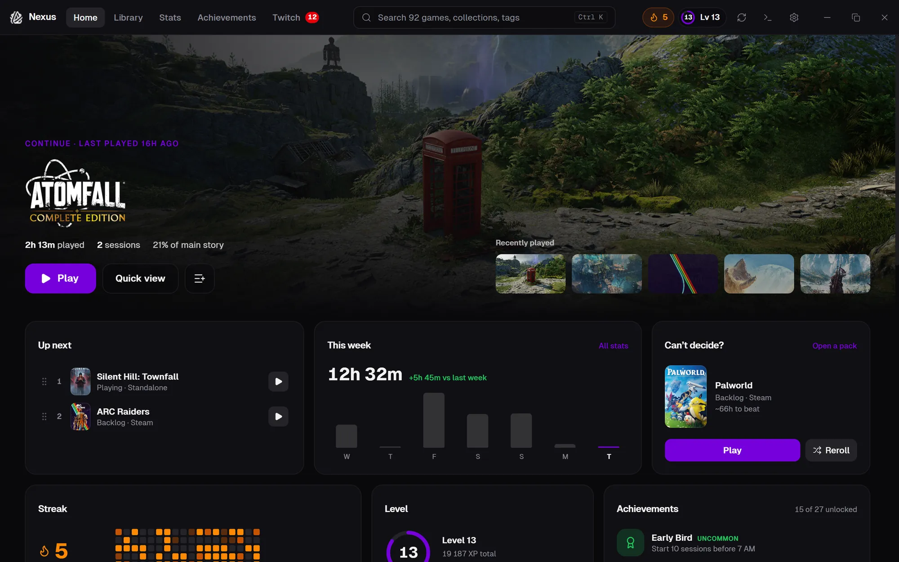
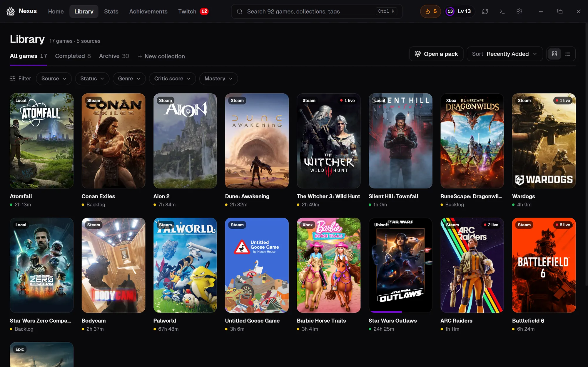
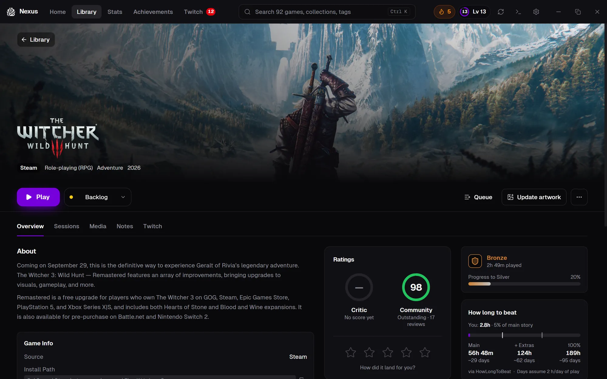
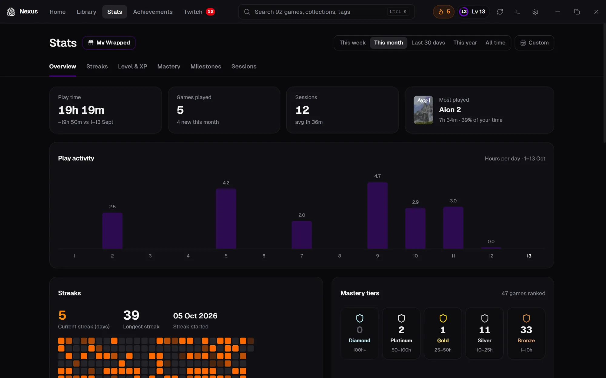
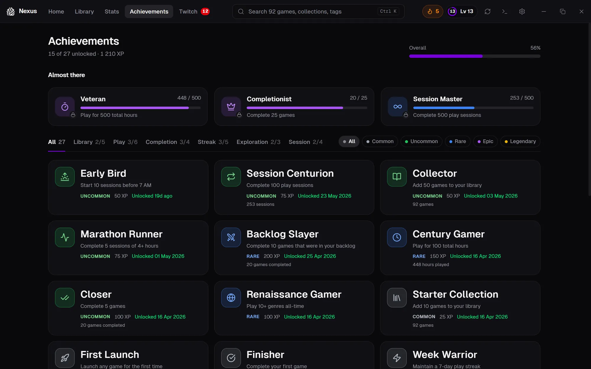
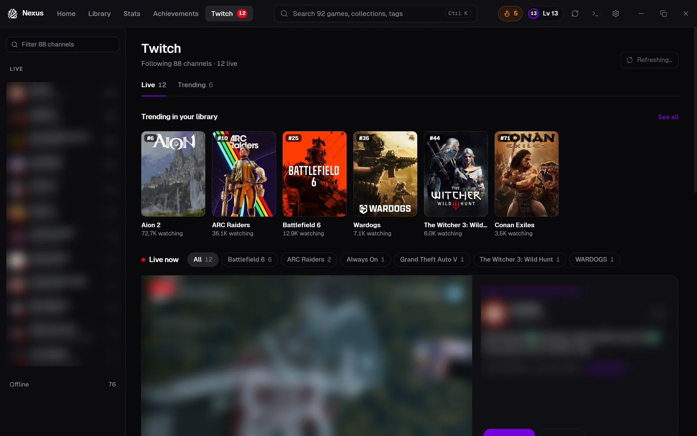
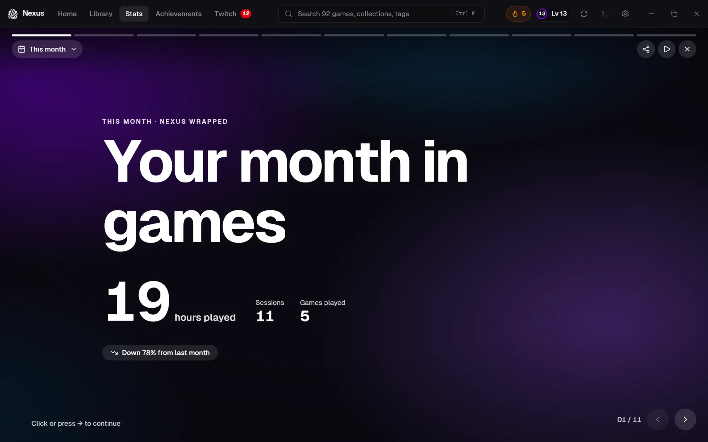
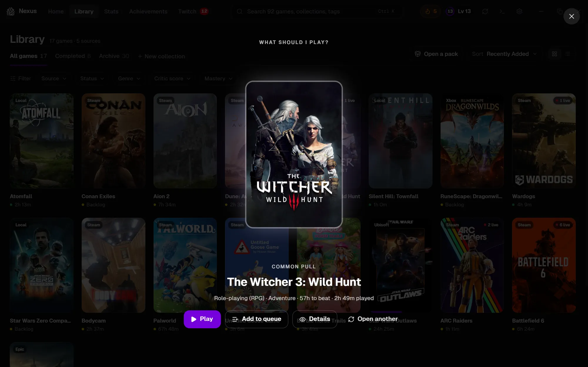
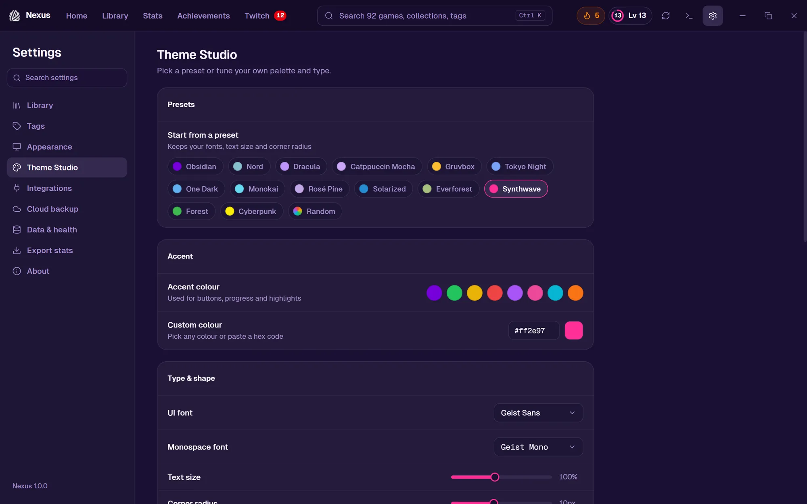

<div align="center">


# Nexus

### All your games. One place.

A fast, local-first game launcher for Windows.<br>
Steam, Epic, GOG, Ubisoft Connect, Battle.net, Xbox and your own folders, in one library.

<br>

[](https://www.nexusgamelauncher.com/changelog.html)
[](https://www.nexusgamelauncher.com/#download)
[](https://tauri.app)
[](LICENSE)
[](https://discord.gg/dh2tDGJNYD)

<br>

<a href="https://www.nexusgamelauncher.com/#download"></a>

<sub>Free &nbsp;·&nbsp; 12 MB &nbsp;·&nbsp; No account &nbsp;·&nbsp; Updates itself</sub>

<br>

**[Website](https://www.nexusgamelauncher.com)** &nbsp;·&nbsp;
**[What's new](https://www.nexusgamelauncher.com/changelog.html)** &nbsp;·&nbsp;
**[Discord](https://discord.gg/dh2tDGJNYD)** &nbsp;·&nbsp;
**[Report a bug](https://github.com/darrenstrydom85/nexus_game-launcher/issues)**

<br>



</div>

<br>

## Finds your games, wherever they live

Nexus scans your PC on first launch and keeps watching. No logins, no API keys, nothing to configure.

<div align="center">

**Steam** &nbsp;·&nbsp; **Epic Games** &nbsp;·&nbsp; **GOG** &nbsp;·&nbsp; **Ubisoft Connect** &nbsp;·&nbsp; **Battle.net** &nbsp;·&nbsp; **Xbox / Game Pass** &nbsp;·&nbsp; **Your own folders**

</div>

Press **Play** and the right launcher starts in the background, while Nexus times the session.

<br>

## A closer look

<table>
  <tr>
    <td width="50%" valign="top">
      
      <h3>One library, every launcher</h3>
      Covers, genres and critic ratings from IGDB. Filter by source, status, genre, score or mastery, or hit <kbd>Ctrl</kbd> <kbd>K</kbd> from anywhere.
    </td>
    <td width="50%" valign="top">
      
      <h3>Game pages that go deep</h3>
      Ratings, screenshots, similar games, Twitch, and How Long to Beat with your own progress marked on the bar.
    </td>
  </tr>
  <tr>
    <td width="50%" valign="top">
      
      <h3>Every minute, tracked</h3>
      Sessions timed across every source, compared with the last period. Daily streaks, a play heatmap and mastery tiers from Bronze to Diamond.
    </td>
    <td width="50%" valign="top">
      
      <h3>Level up as you play</h3>
      Earn XP from every session. Native achievements with rarity, and an <i>Almost there</i> row for the ones you're close to.
    </td>
  </tr>
  <tr>
    <td width="50%" valign="top">
      
      <h3>Twitch, built in</h3>
      See who's live for the games you own, what's trending in your library, and jump into channel pages and clips.
    </td>
    <td width="50%" valign="top">
      
      <h3>Wrapped, any time</h3>
      Your month or year as a story you step through: top games, genres, when you play, milestones. Share it when you're done.
    </td>
  </tr>
  <tr>
    <td width="50%" valign="top">
      
      <h3>Can't decide? Open a pack.</h3>
      Rip open a pack and Nexus flips over a card with your next game. Don't like it? Reroll.
    </td>
    <td width="50%" valign="top">
      
      <h3>Make it look like yours</h3>
      Theme Studio: 14 presets from Obsidian to Synthwave, any accent colour, your own fonts, text size and corner radius.
    </td>
  </tr>
</table>

<br>

## Every feature

<details>
<summary><b>Library</b> &nbsp;·&nbsp; 7</summary>
<br>

- **Auto-import** from Steam, Epic, GOG, Ubisoft Connect, Battle.net and Xbox
- **Your own folders**: watch a folder and the standalone games inside show up
- **Rich metadata**: covers, descriptions, genres and critic ratings from IGDB
- **Instant launch**: the right launcher starts in the background
- **Game pages** with ratings, How Long to Beat, screenshots, similar games and Twitch
- **Quick view**: a drawer slides in beside the library with the essentials
- **Archive**: keep track of games after they're uninstalled

</details>

<details>
<summary><b>Tracking</b> &nbsp;·&nbsp; 6</summary>
<br>

- **Play time**: accurate sessions across every source
- **Stats**: side-by-side cards, comparisons with the last period and an activity chart
- **Streaks**: a daily play streak with a heatmap of your play
- **Mastery tiers**: Bronze to Diamond for every game you put hours into
- **Achievements and XP**: native achievements, rarity and a launcher-wide level
- **Wrapped**: your month or year as a story you step through and share

</details>

<details>
<summary><b>Organise</b> &nbsp;·&nbsp; 6</summary>
<br>

- **Collections**: hand-picked shelves you can drag to reorder
- **Smart collections**: rules that keep a collection up to date for you
- **Search and filters**: <kbd>Ctrl</kbd> <kbd>K</kbd> from anywhere; filter by source, status, genre, score or mastery
- **Up next**: a play queue you can reorder
- **Notes and tags**: notes per game and colour-coded tags across the library
- **Completed shelf**: every game you've finished, in one place

</details>

<details>
<summary><b>Connect</b> &nbsp;·&nbsp; 4</summary>
<br>

- **Twitch**: who's live for your games, trending in your library, channel pages and clips
- **How Long to Beat**: time to beat and what's left, based on your own play
- **SteamGridDB**: swap covers, logos and hero art
- **Google Drive backup**: encrypted backups to your own Drive, on your schedule

</details>

<details>
<summary><b>Experience</b> &nbsp;·&nbsp; 7</summary>
<br>

- **Open a pack**: rip open a pack and flip a card to pick your next game
- **Theme Studio**: 14 presets, any accent colour, fonts, text size and corner radius
- **Retro mode**: turn the library into a DOS-era terminal, one click away
- **Now playing widget**: a small card on your desktop with a timer and a Stop button while Nexus is minimized
- **Local-first**: no account; your library lives in one SQLite file on your PC
- **Works offline**: cached art and data when you're disconnected
- **System tray**: minimise to the tray and launch games from it

</details>

<br>

## Yours, on your PC

- **No account.** Install it and go.
- **Your library is one SQLite file** in `%APPDATA%\nexus\`. Back it up, move it, delete it.
- **Backups go to your own Google Drive**, encrypted, only if you turn them on.
- **One anonymous count a day**, with no ID, only after you've answered the notice. The [counter's code](nexus/src/lib/usageCount.ts) and its [public dashboard](https://stats.nexusgamelauncher.com/) are both open.

Read the full [privacy policy](https://www.nexusgamelauncher.com/privacy.html).

<br>

## Under the hood

Small, native and fast: a Rust core on Tauri 2 and the system WebView2, with no bundled Chromium.

| Layer | Stack |
|:--|:--|
| **Desktop shell** | Tauri 2 (Rust), WebView2 |
| **Frontend** | React 19, TypeScript, Vite 7 |
| **Styling** | Tailwind CSS 4, Radix UI, Geist Sans / Mono |
| **State** | Zustand |
| **Backend** | Rust: rusqlite, reqwest, tokio, winreg, notify |
| **Updates** | Tauri updater with signed releases |
| **Tests** | Vitest + Testing Library, `cargo test` |

<br>

## Build from source

<details>
<summary><b>Prerequisites</b></summary>
<br>

- **Node.js** 20+ and npm
- **Rust**, latest stable via [rustup](https://rustup.rs)
- **[Microsoft C++ Build Tools](https://visualstudio.microsoft.com/visual-cpp-build-tools/)** for native dependencies
- **[WebView2](https://developer.microsoft.com/en-us/microsoft-edge/webview2/)**, preinstalled on Windows 11

</details>

The app lives in [`nexus/`](nexus). Run everything from there:

```powershell
cd nexus
npm install
npm run tauri dev
```

The window opens with hot reload; the frontend is served at `http://localhost:1420`.

```powershell
npm run tauri build
```

Installers (NSIS and MSI) land in `nexus/src-tauri/target/release/bundle/`.

<details>
<summary><b>All scripts</b></summary>
<br>

| Command | What it does |
|:--|:--|
| `npm run tauri dev` | Full app: frontend + Rust, with hot reload |
| `npm run tauri build` | Production build and installers |
| `npm run dev` | Vite dev server only, no Tauri |
| `npm run build` | `tsc` + `vite build` |
| `npm run preview` | Preview the Vite production build |
| `npm run test` | Run Vitest once |
| `npm run test:watch` | Vitest in watch mode |
| `cargo test` | Rust tests, run from `nexus/src-tauri` |

</details>

<details>
<summary><b>Optional integrations</b></summary>
<br>

All optional, all set up in **Settings**.

- **IGDB** (via Twitch): metadata and ratings. *Settings → Integrations*
- **SteamGridDB**: custom covers, logos and hero art. *Settings → Integrations*
- **Twitch**: live channels, trending and clips. *Settings → Integrations*
- **Google Drive**: encrypted cloud backup and restore. *Settings → Cloud backup*

</details>

<details>
<summary><b>Repository layout</b></summary>
<br>

```
.
├── nexus/                  The desktop app
│   ├── src/                React + TypeScript frontend
│   │   ├── components/     UI components
│   │   ├── modern/         The 1.0 layout
│   │   ├── retro/          Retro mode
│   │   ├── stores/         Zustand stores
│   │   ├── hooks/          React hooks
│   │   ├── lib/            API bindings and utilities
│   │   └── __tests__/      Component and integration tests
│   └── src-tauri/          Rust backend
│       └── src/
│           ├── commands/   Tauri invoke handlers
│           ├── db/         SQLite schema and migrations
│           ├── sources/    Steam, Epic, GOG, Xbox, Battle.net, Ubisoft, folders
│           ├── metadata/   IGDB, SteamGridDB, How Long to Beat
│           ├── twitch/     Twitch OAuth and API
│           └── gdrive/     Google Drive backup
├── nexus-website/          nexusgamelauncher.com, releases and update manifest
├── nexus-stats/            Cloudflare Worker behind the anonymous usage count
└── docs/                   Maintenance notes
```

</details>

<br>

## Contributing

Bug reports, ideas and pull requests are welcome. Start with [CONTRIBUTING.md](CONTRIBUTING.md), then:

1. Run `npm run tauri dev` from `nexus/` and make your change.
2. Run `npm run test`, and `cargo test` in `nexus/src-tauri`.
3. Open a pull request against `main`.

Questions? Come say hi on [Discord](https://discord.gg/dh2tDGJNYD).

<br>

## License

[MIT](LICENSE) © 2026 Darren Strydom

<br>

<div align="center">

<br>
<sub>Made for people who play.</sub>
</div>
